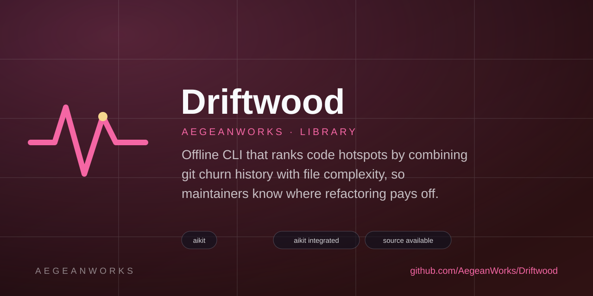

# Driftwood

<!-- aegean:media:start -->
<p align="center"></p>
<p align="center"><a href="LICENSE"></a> <a href="https://github.com/AegeanWorks/AIKit"></a></p>
<!-- aegean:media:end -->


Offline CLI that ranks code hotspots by combining git churn history with file complexity, so maintainers know where refactoring pays off.

## ⚡ 30-Second Cold-Start Quick Reference

- **Runtime Prerequisites**: Python 3.10+ and git 2.20+ (already used by the repository you analyze). No third-party packages.
- **Canonical Regression Shield Gate**:
  ```bash
  python -m unittest discover -s tests -t .
  ```

### Run it

```bash
# From this project root: rank the 20 hottest files in the current repository
python -m driftwood

# Point it at another checkout, last 12 months only, as JSON
python -m driftwood ../my-repo --since 12.months.ago --format json

# Focus on source files
python -m driftwood . --include "src/*" --top 10
```

Example table:

```text
#  Score  Churn  Cplx  Commits  File
-  -----  -----  ----  -------  ----
1  1.000  521    37    48       src/engine/scheduler.py
2  0.734  310    12    22       src/api/routes.py
```

### How the score works

Every file touched by history gets two normalized metrics:

- **Churn** = added + deleted lines, bounded by `--since` / `--commits`.
- **Complexity** = 1 + decision points; Python uses tokens, other text files a line heuristic.

The score is `0.6 * churn + 0.4 * complexity`, both min-max scaled across the selected files, so a score of `1.000` marks the file that is both the most rewritten and the most branch-heavy. When a metric has no spread (for example a repository with a single churned file) its positive values saturate at `1.0`, so a real hotspot is never reported as `0.000`. Candidates with zero signal are skipped, and ties break on path to keep runs deterministic.

Complexity is deliberately a cheap heuristic, not a linter: it counts decision points and ignores formatting. Git's rename notation is folded into the newest path, binary files are skipped, and files deleted from the work tree keep their churn with complexity `0`.

### Options

| Flag | Meaning |
|---|---|
| `repo` | Path inside the git work tree (default: `.`) |
| `--since <date>` | Passed to `git log --since`, e.g. `6.months.ago` |
| `--commits <n>` | Only the newest `n` commits |
| `--top <n>` | Rows to print (default: 20) |
| `--format table\|json` | Human table or scriptable JSON |
| `--include GLOB` / `--exclude GLOB` | Repeatable path filters (`*` also spans `/`) |
| `--min-score <f>` | Hide rows below a score, applied before `--top` |

Numeric flags are validated up front: `--top` and `--commits` need a positive integer, `--min-score` needs a non-negative number, and a rejected value exits `2` with usage instead of a stack trace.

Exit codes: `0` success (including an empty report), `1` git/IO failure with `Why:` and `Fix:` guidance, `2` invalid arguments.

## 📦 What's Inside

```text
driftwood/
├── driftwood/
│   ├── cli.py            <- argparse entry point, filters, exit codes
│   ├── gitlog.py         <- git log --numstat parsing and churn aggregation
│   ├── complexity.py     <- Python token and generic line complexity metrics
│   ├── scoring.py        <- normalization, weighting, deterministic ranking
│   └── report.py         <- table and JSON rendering
├── tests/                <- unittest shield for every metric and the CLI
├── pyproject.toml        <- package metadata, console script
├── .gitignore            <- transient AIKit state excluded
├── LICENSE               <- Aegean License 1.1 (AL-1.1): free personal use
├── COMMERCIAL.md         <- Commercial licensing terms
├── LICENSES/             <- REUSE license texts
├── REUSE.toml            <- Machine-readable SPDX metadata
├── README.md
└── .aikit/               <- this project's memory: record, ledger, decisions
```

### 🛠️ AIKit Commands (run from the AIKit folder)

| Role | Command |
|---|---|
| Status, task and gates | `python aikit.py status driftwood` |
| Phase 4: every gate | `python aikit.py check driftwood` |
| Repair memory and map, then check | `python aikit.py fix driftwood` |
| Resume an interrupted task | `python aikit.py resume driftwood` |

<!-- aegean:brand-assets:start -->
## 🎨 Brand Assets

> **AI-Generated Brand Artwork.** The banner and logo are **AI-generated brand assets**. They are illustrative and may not literally depict every feature or the full project scope.
<!-- aegean:brand-assets:end -->

## 📜 License

Free for personal use under the Aegean License 1.1 (AL-1.1); see [LICENSE](LICENSE). Any commercial use needs the Aegean Commercial License 1.0 (ACL-1.0); see [COMMERCIAL.md](COMMERCIAL.md).
